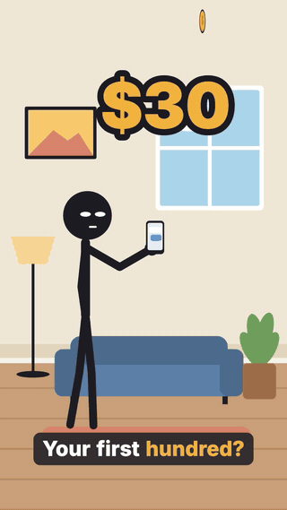
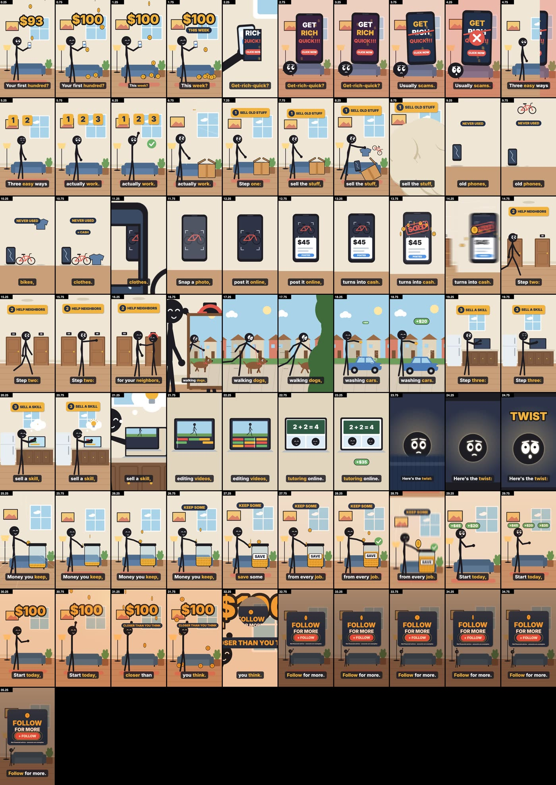
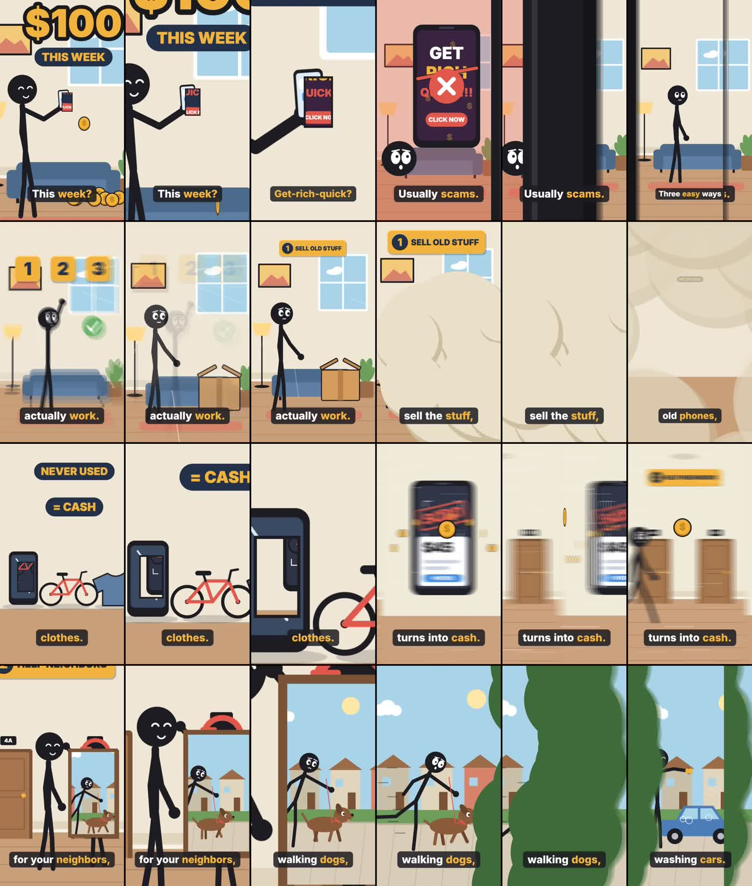
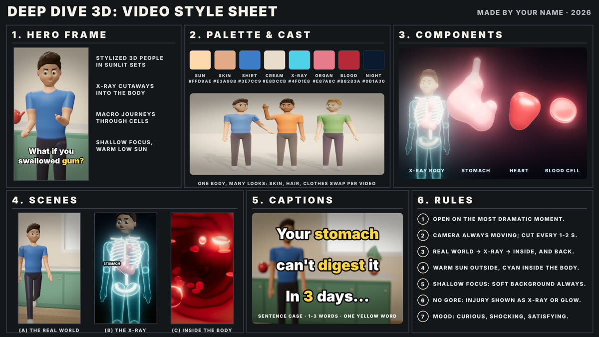
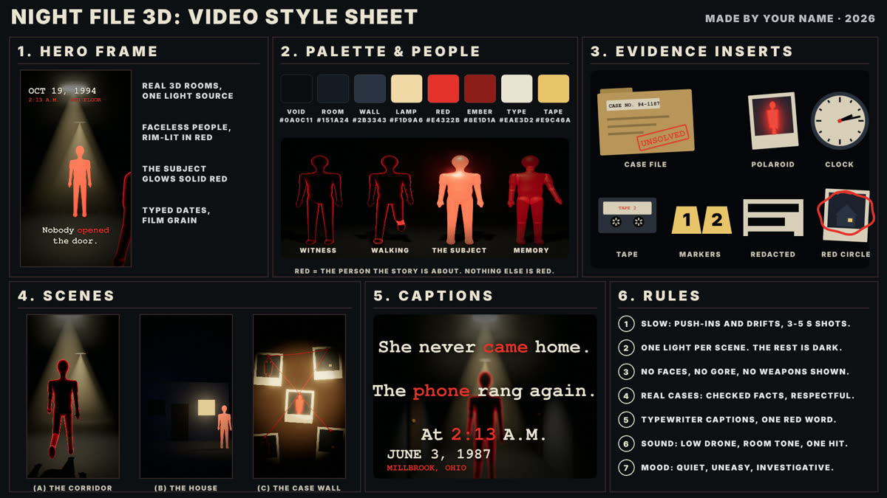
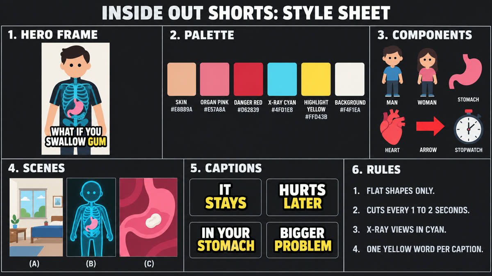
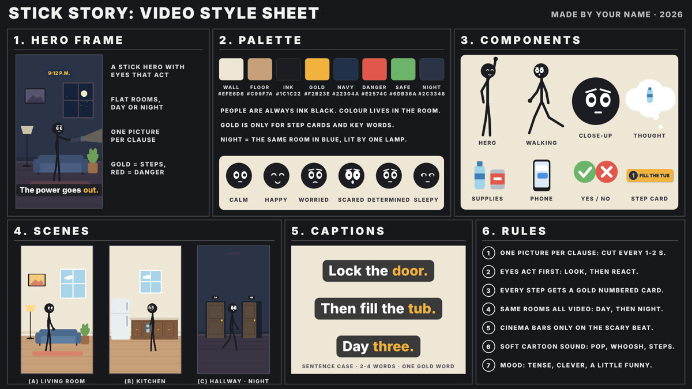
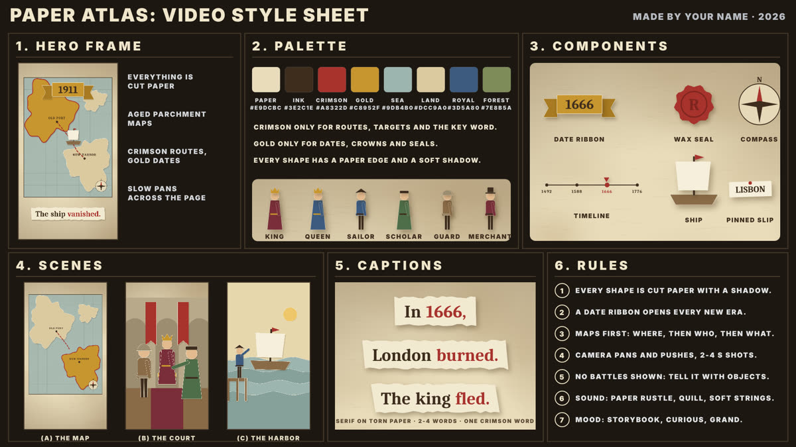
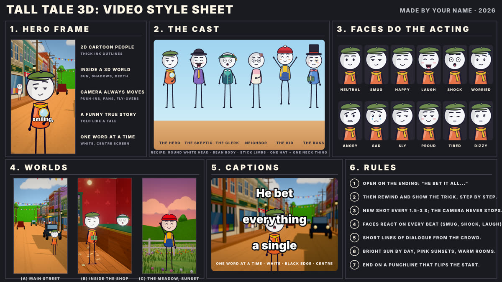

<div align="center">

# 🎬 Reels Create

### Type a topic. Get a finished vertical short.
**Script · AI voice · word-synced captions · animated shots · sound & music · rendered MP4**
all generated as code, on your own machine, with **no AI video, no API keys and no credits.**

<br>

[](assets/demo-easy-money.mp4)

<sub>▶ Click the preview to play the full 35 s video, made from one sentence: <i>"create me a how to earn money in easy way"</i></sub>

<br>


</div>

---

## ✨ What it does

You tell Claude a topic. The skill plans a retention-first short, shows you the plan, and after your OK it builds and renders the whole thing:

| Step | What happens | Tool |
|---|---|---|
| 📝 **Script** | A hook on frame 0, a new reason to keep watching every ≤ 5 s, a twist, a payoff, a follow call to action | Claude |
| 🎙️ **Voice** | Natural narration, spoken locally | Kokoro-82M |
| ⏱️ **Timing** | Every word timed, so each cut and caption lands on its word | faster-whisper |
| 🎨 **Animation** | Characters, rooms, props and kinetic type, with a **flow-motion camera** that follows the action from scene to scene, all drawn in code | Canvas / three.js + headless Chrome |
| 🔊 **Sound** | Whooshes, pops, thuds and a music bed, synthesized | numpy / scipy |
| 🎞️ **Render** | Every frame captured and encoded, loudness set to -14 LUFS | ffmpeg |
| 🔍 **Self-audit** | Claude reads contact sheets and key frames, logs every fix and re-checks neighbours | built in |

## 🎥 Reference: the demo video

[`assets/demo-easy-money.mp4`](assets/demo-easy-money.mp4) · 35 s · 1080×1920 · -14 LUFS · **style: Stick Story**

> *"3 Easy Ways to Make Your First $100"* was made from a one-line request. It has 15 shots, each with its own signature move, and **no hard cuts**: the camera flies into the phone, rides a coin to the neighbors, goes through the front door, passes a hedge, and dives into the laptop.

[](assets/demo-contact-sheet.jpg)
<sub>Contact sheet (a frame every 0.5 s), the same one Claude reviewed before rendering.</sub>

**What's in it**

| Time | Beat | Signature move |
|---|---|---|
| 0.0 s | **Hook:** "Want your first hundred dollars this week?" | A gold `$100` counter rolls up and locks on the word *hundred* while coins rain down |
| 2.2 s | **Myth bust** | A flashing "GET RICH QUICK" ad is struck out and a red ✕ slams in on *scams* |
| 7.0 s | **Step 1: sell unused stuff** | The box tips and items arc out and land with a squash |
| 11.2 s | Snap, post, sold | A zoom-through into the phone, then a `SOLD` stamp and a coin burst |
| 14.6 s | **Step 2: help neighbors** | A walk, a knock, a door swing, then a dog drags the hero down a parallax street |
| 19.2 s | **Step 3: sell a skill** | A video-edit timeline builds itself, then a tutoring call |
| 23.8 s | **Twist** | Near-silence, a glitch cut, and `TWIST` slams in |
| 25.3 s | Keep some | Coins arc into a `SAVE` jar that fills up |
| 28.9 s | **Payoff** | `+$45 +$20 +$35` fly together and the counter locks on **$100** |
| 32.3 s | **Follow** | An iris opens on a follow card with a pulsing button |

The script, shot list and the log of QA fixes are in [`examples/easy-money/`](examples/easy-money).

## 🌊 Flow motion: the camera never cuts

Modeled on story-cartoon shorts that hold viewers for a full minute (8 to 21 million views each). We studied their
camera frame by frame and rebuilt the craft in code; their stories, characters and shots are not copied. In every
style, each scene change is a **hand-off caused by the world**:

| hand-off | on screen | example in the demo |
|---|---|---|
| `carry` | the camera rides along with a moving object | a coin flies from the SOLD phone to the neighbors' hallway |
| `portal` | the camera flies through a door, window, screen or hole | into the phone, through the front door, into the laptop |
| `smoke` | smoke, dust or foam fills the lens and parts on the new place | dust from the tipped box, soap foam from the car wash |
| `pass` | something close to the lens sweeps across | a post, a hedge, a falling blind |
| `dive` | the camera dollies forward through the shot | into step tile "1" |

[](assets/demo-handoffs.jpg)
<sub>Three frames through each hand-off: the camera carries through every scene change.</sub>

Inside shots the camera keeps travelling (`camPath` in 2D, spline `pathCam` and chase `followCam` in 3D), and the light
moves from day to sunset to night with the story (`tod`). `capture.mjs check` turns any leftover hard cut into an
automatic hand-off and lists it, so every video flows even before it's polished. The rules are in
[`references/flow-motion.md`](references/flow-motion.md).

## 🎭 Six visual styles

Each style has a style sheet, a rulebook (`STYLE.md`) and a complete example project that renders as-is.

<table>
<tr>
<td align="center" width="33%"><br><b>Deep Dive 3D</b><br><sub>"What happens if…?" body and science, in 3D</sub></td>
<td align="center" width="33%"><br><b>Night File 3D</b><br><sub>Unsolved mysteries and true crime</sub></td>
<td align="center" width="33%"><br><b>Inside Out</b><br><sub>Flat 2D x-ray explainers; money and data</sub></td>
</tr>
<tr>
<td align="center"><br><b>Stick Story</b><br><sub>Survival steps, life hacks, how-tos</sub></td>
<td align="center"><br><b>Paper Atlas</b><br><sub>History in cut paper and maps</sub></td>
<td align="center"><br><b>Tall Tale 3D</b><br><sub>Funny true stories, cartoon people in a 3D town</sub></td>
</tr>
</table>

Claude picks the style from your topic: body or science → Deep Dive or Inside Out · mystery → Night File · "what would you do if…" → Stick Story · history → Paper Atlas · a funny true story → Tall Tale. If it isn't obvious, it asks once.

## 🧲 Built for retention

Every video, in every style, follows [`references/retention.md`](references/retention.md):

- **Hook on frame 0:** no black frame, no "in this video", and the voice starts within 0.1 s.
- **A re-hook at least every 5 seconds:** open loops, numbered steps, myth busts, twists.
- **No dead frames and no hard cuts:** something is always moving, and every scene change is a flow hand-off (carry, portal, smoke, pass, dive).
- **One emotion per shot:** shown through the face, the colour and the sound.
- **A follow call to action:** spoken, with an animated follow card at the end, or a seamless **loop ending** for story shorts.
- **Story explainers:** a hero with a strange idea and a rival who mocks it, the science shown inside the world (heat-colored rails, newspaper headlines), a running sound gag, and a turn to the viewer's own life.

And three gates before anything is rendered ([`references/audit.md`](references/audit.md)): a **change audit** (every fix is logged and the whole sheet re-checked), a **zero-overlap audit** (text, faces, captions and the phone safe zone), and an **animation quality bar** (a signature move in every shot, with no linear tweens).

## 🚀 Install

```bash
git clone https://github.com/PLATMAN02/reels-create.git ~/.claude/skills/faceless-shorts
bash ~/.claude/skills/faceless-shorts/scripts/setup.sh   # first run only, ~1 GB for the voice and Whisper models
```

Needs Claude Code (CLI or desktop app), Node.js 22+, ffmpeg, Google Chrome and Python 3.10+. On Windows, run the scripts in Git Bash.

## 💬 Use it

In a new Claude Code session:

```text
/faceless-shorts how to earn money in an easy way
```

or just ask: *"Make a Deep Dive 3D short: what happens if you crack your knuckles?"*

Claude will ask only what it doesn't know, show you the plan (hook, narration, shots, re-hook timeline, ending) and wait for your **"Build it?"**. It then renders and QAs the video and hands you the MP4, a cover frame, a title, a caption and hashtags.

**Other modes**
- 🎤 **Your own voice:** record the script yourself and the video is timed to your recording.
- 🔇 **Captions only:** no voice, timed by an estimate.
- 🧒 **Cartoon audio mode:** see [`references/cartoon-audio.md`](references/cartoon-audio.md).
- 📺 **Long-form:** chaptered multi-minute videos, see [`references/long-form.md`](references/long-form.md).
- 📤 **Publishing:** only when you ask, see [`references/publishing.md`](references/publishing.md).

## 🧩 How it works

```text
script.json ─► Kokoro voice ─► Whisper word times ─► shots drawn in code ─► synthesized sound + music
                                                                    │
                       headless Chrome captures every frame ◄───────┘
                                      │
                                      ▼
                          ffmpeg ─► MP4 (-14 LUFS)
```

```text
.
├── SKILL.md            what Claude follows
├── scripts/            setup, selftest, new_video, voice, words, estimate
├── styles/<style>/     style-sheet.png · STYLE.md · example/ (a complete project)
├── references/         flow motion · retention · audit · motion vocabulary · cartoon audio · long-form · publishing
├── examples/           the demo video's script, shots and QA log
└── assets/             demo video, preview, contact sheet, style sheets
```

## ⚖️ Honesty rules baked in

Real, sourced numbers only, with charts drawn to scale · no real brands or likenesses · health and safety advice checked against reliable sources · the demo's dollar amounts are labelled as examples, and "get-rich-quick" claims are called out as scams rather than promoted.

## 📄 Licenses

The code, stories, drawings and sound are original and free to use in your videos. Inter font: SIL Open Font License 1.1. Installed on first use: Kokoro-82M (Apache-2.0) via kokoro-onnx (MIT), faster-whisper and Whisper small.en (MIT), numpy and scipy.

<div align="center"><sub>Made with Claude Code</sub></div>
